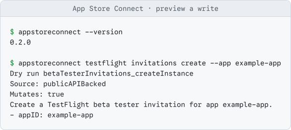

<div align="center">

<p align="center">
  <a href="https://github.com/swift-library/swift-appstoreconnect"></a>
</p>

<h1 align="center">swift-appstoreconnect</h1>

<p align="center">
  Build typed App Store Connect integrations and preview CLI writes before confirming them.
</p>

<p align="center">
  <a href="https://github.com/swift-library/swift-appstoreconnect/actions/workflows/ci.yml"></a>
  
  
  <a href="LICENSE.txt"></a>
</p>

<p align="center">
  <a href="#overview">Overview</a> ·
  <a href="#quick-look">Quick look</a> ·
  <a href="#install">Install</a> ·
  <a href="#usage">Usage</a> ·
  <a href="#requirements">Requirements</a> ·
  <a href="#documentation">Documentation</a> ·
  <a href="#contributing">Contributing</a> ·
  <a href="#license">License</a>
</p>

</div>

## Overview

Select the App Store Connect domains your integration needs and send typed requests from the locked API specification. Implemented CLI writes produce a dry-run plan by default and require `--confirm` to execute; the [usage guide](Documentation/Reference/Usage.md) distinguishes executable operations, workflow plans, and experimental APIs.

## Quick look

Preview a TestFlight invitation without credentials:

<p align="center">
  <picture>
    <source media="(prefers-color-scheme: dark)" srcset=".github/assets/terminal/terminal-dark.svg">
    <source media="(prefers-color-scheme: light)" srcset=".github/assets/terminal/terminal-light.svg">
    
  </picture>
</p>

## Install

Add the dependency and select the products your target imports:

```swift
dependencies: [
    .package(
        url: "https://github.com/swift-library/swift-appstoreconnect.git",
        .upToNextMinor(from: "0.2.0")
    )
],
targets: [
    .target(
        name: "YourTarget",
        dependencies: [
            .product(name: "AppStoreConnectCore", package: "swift-appstoreconnect"),
            .product(name: "AppStoreConnectPublicAPI", package: "swift-appstoreconnect"),
            .product(name: "AppStoreConnectWorkflow", package: "swift-appstoreconnect")
        ]
    )
]
```

> [!NOTE]
> swift-appstoreconnect is pre-1.0. Minor releases may include source-breaking
> changes, so depend on it with `.upToNextMinor(from:)`.

## Usage

Select domain traits for the typed API surface your application uses, or choose a CLI command from `appstoreconnect commands list --json`. The [usage guide](Documentation/Reference/Usage.md) covers client construction, credentials, command plans, supported execution, and trait boundaries.

## Requirements

Swift 6.3 or later; iOS 18, macOS 15, tvOS 18, watchOS 11, or visionOS 2 or later.
Xcode integration requires Xcode 26.4 or later. Local Xcode process execution
requires macOS. Package checks cover the default,
disabled-default, full Public API, and experimental trait configurations.
CI builds the libraries for iOS, tvOS, watchOS, and visionOS;
live API access requires your own credentials and is excluded from public CI.

## Documentation

- [Usage guide](Documentation/Reference/Usage.md): examples, behavior, and limits.
- [API documentation](https://swift-library.github.io/swift-appstoreconnect/): module reference and usage.
- [Command guide](Sources/AppStoreConnectCLI/AppStoreConnectCLI.docc/CommandGuide.md): commands, traits, and execution boundaries.
- [Documentation index](Documentation/README.md): module design and architecture.
- [Release](Documentation/Reference/Release.md): release facts and mechanics; version rules are in VERSIONING.
- [Specification lock](Vendor/AppStoreConnectOpenAPI/spec.lock.json): Apple specification source and checksums.
- [Changelog](CHANGELOG.md): release history.

## Contributing

See [CONTRIBUTING.md](CONTRIBUTING.md) for local build, test, formatting, and
OpenAPI checks. CI also builds all six module documentation catalogs and
checks the [terminal demonstration](Documentation/Reference/TerminalDemo.md).
Report security issues through [SECURITY.md](SECURITY.md).

## License

Package code is licensed under [Apache-2.0 with the Swift exception](LICENSE.txt).
Apple's specification is governed separately; see [NOTICE](NOTICE) for its
ownership and applicable terms. This independent project is not affiliated with
or endorsed by Apple. App Store Connect is a trademark of Apple Inc.
